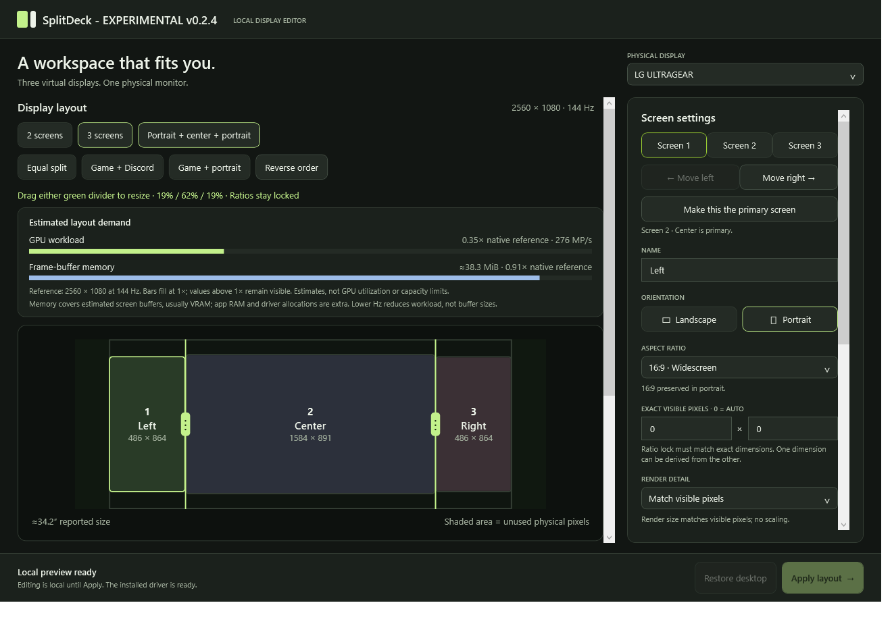

# SplitDeck

SplitDeck is an experimental Windows app that presents two or three virtual monitors on one physical display. You can give each region its own shape, visible size, render resolution and refresh target. A game and Discord can use separate Windows displays while sharing an ultrawide panel.

The current candidate is v0.2.4. It fixes competing capture clocks that could make mixed-refresh motion uneven. In a 144/30 Hz comparison, animation-phase presentations increased from 36.61 to 50.10 per second, while total GPU usage stayed around 18.3%. That is a pacing improvement, not a demonstrated GPU reduction or a measurement of displayed FPS. The test needed a browser-only occlusion override; ordinary Chrome/Electron visibility remains an open issue. See the [performance report](docs/performance-v0.2.4.md) for conditions, tradeoffs and limits. Performance equivalent to physical monitors has not been established.



## Download and start

Get `SplitDeck-0.2.4-windows-x64.zip` from [Releases](https://github.com/amirsamidarwish-collab/SplitDeck/releases). Extract the entire ZIP to a folder, then open `SplitDeck.exe`. The portable package includes the .NET runtime and signed driver files; you do not need to install .NET separately. GitHub's source-code ZIP is for building the app and does not contain the portable executable.

1. Select the physical monitor and choose two or three screens. Editing the preview does not change Windows display settings.
2. Click **Setup driver** if shown, then approve Windows' administrator prompt. Setup prepares the managed devices for the selected screen count and leaves them disabled.
3. Click **Apply layout**. The split stays active until you restore it; there is no Keep button or countdown.
4. Click **Restore desktop**, close SplitDeck, or press **Ctrl+Alt+Shift+F12** to end the session.

This release requires a Windows administrator account for setup and activation. Keep the complete extracted folder together, including `assets`. Read [installation](docs/installation.md) before your first Apply. If setup or restoration fails, use [troubleshooting](docs/troubleshooting.md).

## Layout controls

In three-screen mode, drag either green divider in the preview to resize its neighboring screens. The percentages, pixel preview and resource estimates update while you drag. Release to save, or press Escape to cancel. The third screen keeps its share. Exact visible dimensions lock the dividers; set those dimensions to `0` for automatic sizing. Aspect ratios remain locked, so a region can contain unused space when its shape reaches the panel height.


- Choose two or three ordered regions. The three-screen preset has portrait wings and a landscape center, with the center as primary. You can move regions left or right and choose a different primary screen.
- Set an aspect ratio and orientation, or use Fill for a free ratio. Exact visible width and height refer to physical pixels. Automatic regions share the space left after exact widths are reserved.
- Set a separate render resolution when needed. Higher render detail is scaled into the region's visible pixels. Exact visible sizes that conflict with the ratio or exceed the panel are rejected.
- Set refresh targets per screen. The two-screen priority preset starts Screen 1 at 70% width and the panel's refresh target, with Screen 2 at 30 Hz. You can edit those values afterward.

Zero in an exact-size field means automatic. The detected or manually entered diagonal size is descriptive; geometry uses the monitor's pixel dimensions.

Eligible existing app windows on the selected monitor move into the virtual work areas when you apply the split. SplitDeck saves their positions for restoration and preserves their current minimized or maximized state. Some apps enforce a minimum window size that exceeds a narrow region. New windows may also remember a previous monitor; Windows+Shift+Left/Right Arrow can move a window between outputs.

## What the resource bars mean

The GPU bar estimates relative pixel work from the chosen render sizes and refresh targets. It is not a GPU utilization forecast or a reading of your GPU's capacity. The model adds each virtual screen's render pixels per second to the physical output pixels per second, using the highest virtual refresh target for that output term. Its reference is twice the native panel's pixels per second at the detected physical refresh rate.

The memory bar models two BGRA buffers per virtual screen and two for the physical output, at four bytes per pixel. This is usually GPU memory, not total system RAM. It excludes application memory, driver and Windows compositor allocations, and fallback capture buffers. Refresh alone does not change this buffer estimate.

Bars fill at the native reference. Larger values remain visible numerically; a full bar does not establish that the hardware is at capacity or that a lower value is safe.

## Physical and compatibility limits

An equal 16:9 split of a 2560 × 1080 panel produces two 1280 × 720 regions with unused space above and below. Increasing virtual rendering to 3840 × 2160 cannot add physical pixels to those regions. All virtual screens share the physical panel's output cadence.

Windows lists the physical output as well as the two or three virtual outputs. The physical display remains active to present the virtual images. SplitDeck uses GPU texture capture where compatible; its CPU fallback is capped at 30 fps per source and 256 MiB/s of aggregate readback. The session status reports which capture path is active.

The current capture path supports SDR BGRA output. HDR, protected video, exclusive fullscreen, anti-cheat games, relative mouse input, accessibility tools and multi-GPU systems need further compatibility testing. Animated cursor artwork uses its first frame.

Development trials used Windows 10 Pro build 19045, an NVIDIA RTX 2060 and an LG 2560 × 1080 monitor. Two- and three-screen sessions were exercised with Chrome and Discord. A clean installation on a fresh PC has not been tested.

## Build from source

You need Windows x64, a Direct3D 11-capable GPU and the .NET 10 SDK. The portable release already includes its runtime.

```powershell
./build.ps1
./build.ps1 -Publish
```

The full test run needs an awake, unlocked Windows desktop for its graphics checks. For a build that excludes those interactive checks:

```powershell
./build.ps1 -Headless -Publish
```

Published files are under `artifacts/windows-x64`. Builds and component tests do not install the display driver. Driver installation starts through the app's explicit Setup action. A headless test result does not validate capture, cursor behavior or a live split.

| Folder | Contents |
| --- | --- |
| `src/SplitDeck.Core` | Geometry, profiles, presets and resource estimates |
| `src/SplitDeck.Windows` | Driver setup, display modes, capture, presentation and recovery |
| `src/SplitDeck.App` | WPF editor and command entry point |
| `tests` | Component and native test runners |
| `assets/driver` | Pinned signed upstream driver and its license |
| `docs` | Installation and troubleshooting |

## License

SplitDeck uses the [MIT license](LICENSE). The bundled driver is from [VirtualDrivers/Virtual-Display-Driver](https://github.com/VirtualDrivers/Virtual-Display-Driver), release 25.7.23. Read [third-party notices](THIRD-PARTY-NOTICES.md) for driver provenance, hashes and dependency licenses.
